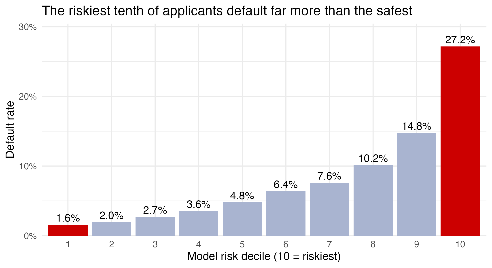
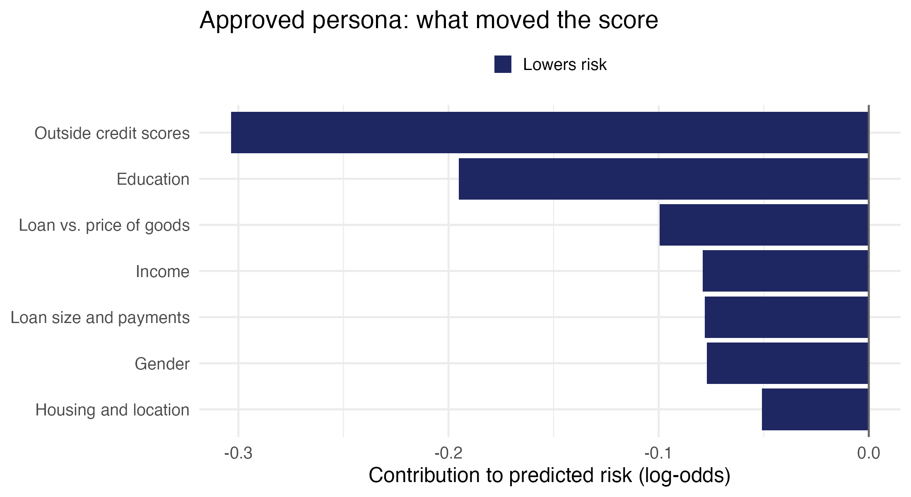
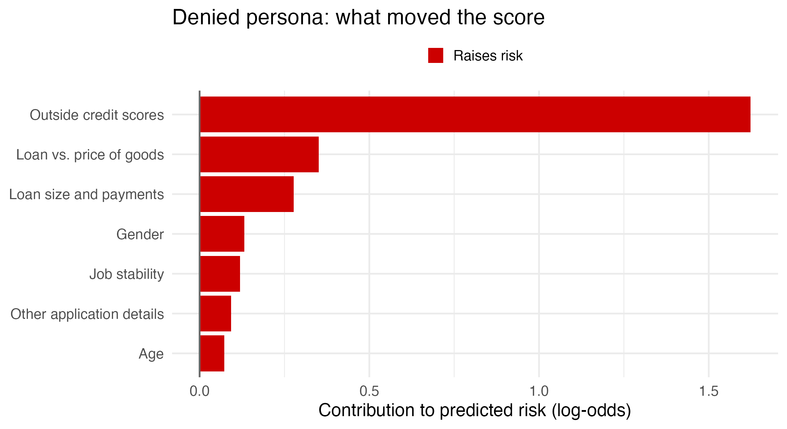

# Home Credit Default Risk | Predictive Modeling & Business Decision Analysis

**Jake Hoopes** · R · tidyverse · caret · XGBoost · SHAP · Quarto · R Markdown

Lenders that serve people with little or no credit history face a hard trade-off. Approve too freely and defaults rise. Screen too strictly and creditworthy borrowers get turned away. Using Home Credit's data on 307,511 past loan applications, I built a credit-risk model. The project covers four steps: exploring the data, engineering features, comparing and validating models, and testing what the model's scores would mean for an actual lending policy.

The project goes beyond a leaderboard score. I connected the model to the decision a lender actually makes: who to approve, who to review, and what changes compared with a simple rule. I finished with a model card that re-validates the model, sets a decision threshold, and tests it for fairness and deployment readiness.

## Key Results

| Result | Value | What it measures |
|---|---|---|
| Final model, holdout ROC AUC | **0.7556** | Final XGBoost model scored once on 61,502 applicants held out from all training and tuning |
| Kaggle score (public / private) | **0.75749 / 0.75276** | Same model specification refit on all labeled data and scored by Kaggle (late submission) |
| Cross-validated ROC AUC | **0.7575** | XGBoost during model selection (3-fold CV on a 50,001-row sample) |
| Default rate: riskiest vs. safest tenth of applicants | **27.2% vs. 1.6%** | Holdout applicants grouped into deciles by predicted risk* |
| Comparison with a "no credit history, no loan" rule | **About 200 fewer defaults per 10,000 applicants** | Illustrative, retrospective comparison at the same 85.7% approval rate* |
| Model card re-validation | **0.7592 CV · 0.7551 holdout** | Separate, stricter re-validation with preprocessing re-learned inside each fold ([Model Card](#model-card-deployment-readiness)) |
| Deployment readiness | **Not ready for automated decisions** | The model card found direct use of gender, marital status, and age, plus undocumented external scores |

\*The decile and policy results use a refit of the same model with the same settings (holdout AUC 0.7550). See [Model Performance](#model-performance) for why the figures differ.

## The Business Problem

Home Credit lends to people that traditional banks often turn away, so many applicants arrive with a thin or missing credit file. Every lending decision risks one of two costly mistakes:

- **Approving someone who defaults** raises credit losses.
- **Rejecting someone who would have repaid** loses revenue and shuts out a creditworthy borrower.

**Accuracy is the wrong yardstick here.** Only 8.07% of applicants had payment difficulties. A "model" that predicts nobody will default is 91.93% accurate and completely useless, because it can't tell one applicant from another. I used **ROC AUC** instead. It measures how well a model *ranks* risky applicants above safe ones: 0.50 is a coin flip and 1.0 is perfect.

**The question I set out to answer:**

> Can predictive modeling identify higher-risk applicants and support better lending decisions without unnecessarily excluding lower-risk borrowers?

## My Analytical Contributions

This is one connected project. I did all of the analysis in the four notebooks, the data-preparation script, and the model card, and each stage builds on the previous one:

- **Exploratory data analysis:** data mapping, integrity checks, missing-value analysis, and nine business questions about default risk.
- **Data cleaning and feature engineering:** I turned each EDA decision into a documented, reusable transformation, built 57 new features, and summarized the credit bureau table, with strict separation between training and test data.
- **Predictive modeling:** compared three algorithms on identical CV folds, tested ways of handling the rare default class, tuned XGBoost, and validated it on an untouched holdout and on Kaggle.
- **Risk segmentation and business decision analysis:** default rates by risk decile, policies that flag the riskiest applicants, and a comparison with a simple "no credit history" rule.
- **Interpretability:** SHAP breakdowns of individual predictions for an approved and a denied applicant.
- **Model card and deployment readiness:**
  - a stricter re-validation of the final model;
  - probability calibration and a decision threshold fixed before the holdout was opened;
  - hypothetical lending economics;
  - a fairness assessment and adverse-action review.
- **Responsible use:** documented leakage risks, fairness findings, and the limits of each result.

## Analytical Approach

| Stage | What I did | Notebook |
|---|---|---|
| **1. Exploratory Data Analysis** | Profiled applicant characteristics, missing values, credit history, and default patterns; documented a data decision for every problem I found | [`eda.qmd`](homecredit-eda/eda.qmd) |
| **2. Data Preparation & Feature Engineering** | Turned the EDA decisions into 167 model-ready features, with every parameter learned from training data only and 10 automated consistency checks | [`data_preparation.R`](data_preparation.R) · [details](docs/data_preparation.md) |
| **3. Predictive Modeling** | Compared ridge logistic regression, random forest, and XGBoost; tested class weighting and downsampling; tuned and validated the final model | [`modeling.qmd`](homecredit-eda/modeling.qmd) |
| **4. Business Impact & Interpretation** | Translated holdout predictions into lending-policy outcomes, then explained individual decisions with SHAP | [`01_business_impact.Rmd`](homecredit-eda/01_business_impact.Rmd) · [`02_personas.Rmd`](homecredit-eda/02_personas.Rmd) |
| **5. Model Card & Deployment Readiness** | Re-validated the model, calibrated its probabilities, set a threshold from scenario economics, and assessed fairness and adverse-action compliance | [`model_card.qmd`](homecredit-eda/model_card.qmd) · [scripts](analysis/model_card/) |

## Key Findings and Business Value

### 1. The model separates high-risk from low-risk applicants sharply



**What this shows:** I ranked 61,502 holdout applicants by predicted risk and split them into ten equal groups. The default rate rises steadily from decile 1 to decile 10, and the riskiest tenth defaults about 17 times as often as the safest. Flagging only that riskiest 10% would catch **33.7% of all defaults** and lower the default rate among remaining applicants from 8.07% to 5.95%. That is the practical value of a good ranking: review effort goes where the risk is.

### 2. Missing information is itself a risk signal

- The 14.3% of applicants with **no credit bureau record** default at 10.12%, against 7.73% for applicants with a history.
- Applicants who left **51 or more fields blank** default at 11.2%, against 6.1% for complete applications, and the rate rises at every step in between.
- An employment value of **365,243 days** (1,000 years) turned out to be a placeholder used almost entirely for pensioners. They default *less* often (5.4% vs. 8.7%), so I treated it as a category rather than an error.

**Why it matters:** a standard "fill the gaps and move on" pipeline would have thrown these signals away. I kept them as explicit flags, which are also easy to explain to an applicant.

### 3. External credit scores carry most of the signal, which brings a trade-off

Features built from three external credit scores account for **about 67% of the model's total gain** (a measure of how much the model relies on each feature). In the EDA, default rates ranged from 3.2% to 20.0% across deciles of a single score. But these scores have no documented derivation, and one is missing for 56.4% of applicants. The strongest signal is therefore the least explainable, and it is thinnest exactly where the business needs it most.

### 4. The model beats simpler approaches

- **Majority-class baseline:** 91.93% accuracy, ROC AUC 0.50.
- **Other algorithms:** XGBoost (0.7575 CV AUC) beat ridge logistic regression (0.7473) and random forest (0.7262) on identical folds, and it led in every fold.
- **A simple lending rule:** see [Business Impact](#business-impact-and-applicant-personas) below.

These are predictive associations. They show which applicant characteristics *go along with* default, not what *causes* it.

## Model Performance

| Result | ROC AUC | Context |
|---|---|---|
| XGBoost, cross-validation | 0.7575 | Model selection: 3-fold CV, 50,001-row development sample |
| Ridge logistic regression, cross-validation | 0.7473 | Model comparison, same folds |
| Random forest, cross-validation | 0.7262 | Model comparison, same folds |
| **Original XGBoost, holdout** | **0.7556** | **Final evaluation:** trained on 246,009 development rows, scored once on 61,502 held-out applicants |
| Kaggle public | 0.75749 | Same specification refit on all 307,511 labeled rows (late submission) |
| Kaggle private | 0.75276 | Same model as the public score, on the remaining Kaggle test applicants |
| Presentation refit, holdout | 0.7550 | Refit with the original hyperparameters; used for all business-impact and persona results |
| Model card, 5-fold CV | 0.7592 ± 0.0011 | Later re-validation on the 246,009 development rows, with preprocessing re-learned inside each fold |
| Model card, holdout | 0.7551 [0.7481, 0.7622] | Development-only model with development-only preprocessing and Platt calibration, scored once on the same 61,502 holdout |

**These numbers aren't interchangeable.** They come from different data, procedures, and fitted models:

- The three CV scores can be compared with each other, but not with the holdout or Kaggle scores.
- The **holdout AUC of 0.7556** is the headline estimate of performance on new applicants. In-sample AUC was 0.7639, a gap of only 0.0083.
- The Kaggle scores come from a model trained on more data and are scored on different applicants. Their closeness to the holdout supports it as a fair estimate.
- The **0.7550 refit** exists because newer package versions give slightly different results (see [Reproducibility](#reproducibility)).
- The **model card's 0.7592 and 0.7551** come from a separate, stricter procedure. Their closeness to the presentation refit's 0.7550 is a coincidence of two different procedures, not the same result. With the original preprocessing, the model card's development-only model reproduces the historical 0.7556 exactly.

I kept XGBoost without class weighting or downsampling. Both adjustments raised sensitivity at a 0.50 cutoff but *lowered* AUC, and ranking is what the business uses.

## Business Impact and Applicant Personas

### Compared with a "no credit history, no loan" rule

A common rule of thumb turns away every applicant without a credit bureau record. I compared that rule with the model turning away the **same number** of holdout applicants, namely the ones it rates riskiest.

| Policy | Approval rate | Default rate of approved loans | Defaults per 10,000 applicants | Applicants with no bureau record approved |
|---|---|---|---|---|
| No credit history, no loan | 85.7% | 7.77% | 666 | 0% |
| Model-based ranking | 85.7% | 5.43% | 465 | 80.1% |

At the same approval rate, the model-based policy has about **200 fewer defaults per 10,000 applicants**. It also approves 80.1% of the applicants with no credit history whom the rule rejects outright. That matches the financial-inclusion goal of the business problem.

**How to read this:** it is a **retrospective, illustrative comparison** on historical holdout data, not a measured real-world outcome.
- The rule is a simplified benchmark, not Home Credit's actual policy.
- No costs, revenue, or loan sizes are included here. The [model card](#model-card-deployment-readiness) adds hypothetical cost scenarios separately.
- Outcomes exist only for loans that were actually issued.

The notebook also includes an equal-default-rate comparison. I don't feature it here because its cutoff was chosen using the holdout outcomes.

### Explaining individual decisions

<p>
  
  
</p>

Under a rule that denies the riskiest 10% of applicants (predicted risk of 17.9% or higher), I used SHAP values to break two holdout predictions into the factors that pushed risk up (red) or down (blue):

- **Approved (predicted risk 3.6%, repaid):** this applicant has *no* credit bureau record but is approved anyway. Strong external scores, university education, and a loan equal to the price of the goods lowered the risk.
- **Denied (predicted risk 60.7%, had payment difficulties):** this applicant *has* a credit history but is denied anyway. Very low external scores and a loan 42% larger than the price of the goods raised the risk.

Together they show that the model does more than apply "no history, no loan." Both applicants keep the same decision under a stricter rule that denies only the riskiest 5%.

**Selection and fairness caveats:**
- I picked these two from filtered candidate lists, based partly on their actual outcomes, because they tell a clear story. They are **illustrative, not representative**.
- **Gender and age contributed to both explanations.** Gender raised the denied applicant's predicted risk and lowered the approved applicant's, and both charts show it. Gender and age are protected characteristics in many lending contexts. The model card's fairness assessment examines this across the whole holdout.
- The explanations describe what the score is *associated with*, not what causes default.

## Model Card: Deployment Readiness

The [model card](homecredit-eda/model_card.qmd) is the final deliverable of the project. It asks whether the final model is fit for real lending decisions, and documents what the model is, how well it performs, how it should and shouldn't be used, and what would have to change before deployment. All of its results come from seven tracked [analysis scripts](analysis/model_card/README.md), and the notebook itself retrains nothing.

**Intended use.** Research-oriented risk ranking only. The target, `TARGET = 1`, means early payment difficulty (a late installment), not a confirmed default or loss. Automated approval or denial is explicitly out of scope.

**Re-validation and calibration.** I re-validated the model with preprocessing re-learned inside each fold: 5-fold CV AUC 0.7592 and holdout AUC 0.7551. The raw XGBoost scores were slightly compressed (calibration slope about 1.08). A Platt correction fitted on development data only brought the holdout calibration slope to 0.99, so a predicted probability can be read as an observed rate.

**Decision threshold and trade-offs.** A threshold of **0.25** on calibrated probability was derived from scenario economics and **fixed before the holdout was opened**. On the holdout:
- it approves 94.9% of applicants;
- 33.6% of declined applicants actually had payment difficulty (precision);
- it declines 21.1% of all payment-difficulty cases (recall);
- the payment-difficulty rate among approved applicants falls from 8.07% to 6.71%.

**Hypothetical economics.** Under the base 24-month scenario, the threshold gains an estimated **+$15.84 per applicant** over approving everyone (95% bootstrap CI +$12.86 to +$19.07). Under a 36-month term the gain is +$0.79, with an interval that spans zero. These are **scenario estimates built on stated assumptions**, some unsourced (such as the share of payment difficulties that become losses), not observed profits. The sources are in the [lending-economics research](analysis/model_card/step2_lending_economics.md).

**Fairness findings** (holdout, at the 0.25 threshold):
- **Gender:** approval is 96.3% for women and 92.4% for men, a 3.9-point gap. Men who would have repaid are declined about twice as often as women (5.6% vs 2.7%). Roughly two-thirds of the gap comes from the model's direct use of gender, its fourth most influential input.
- **Education:** approval is 98.1% for higher education and 93.9% for secondary education. Secondary-educated repayers are declined 3.1 times as often.
- **Age:** some applicants aged 62 and over receive a risk-raising age contribution, which U.S. Regulation B does not allow.
- **Criteria met and not met:** ranking quality and calibration are about equal across groups, but approval parity and equal error rates are not met.
- Statistical disparities alone neither prove nor rule out unlawful discrimination.

**Adverse-action reasons.** For 98% of sampled declined applicants, the main risk-raising factor is an undocumented external score, so the model cannot give the specific, accurate reasons U.S. rules require.

**Recommendation: keep the model as a research baseline, not for automated lending.** Deployment would first require all of the following:
- legal review of restricted inputs;
- a rebuilt, compliant model validated the same way;
- documented external scores and tested reason codes;
- validation against real loss and cost data;
- independent validation with fairness and drift monitoring.

## Limitations and Responsible Use

- **Target-informed feature choices.** Some EDA-based choices, such as missing-value flags and band cutoffs, used the outcome on the full training data before cross-validation, including the holdout rows. The model card's fold-specific re-preprocessing found the *learned parameters* made a negligible difference (AUC +0.00002). The EDA-derived choices themselves could not be refit.
- **Fairness problems were found, not resolved.** The modeling notebook did not analyze fairness. The model card later found disparities by gender and education, and direct use of protected characteristics (see above). No compliant alternative model has been built.
- **Dependence on external scores.** About two-thirds of the model's gain comes from scores whose derivation is undocumented, which blocks specific adverse-action reasons. My EDA recommended a second model without these scores to measure that trade-off. It was not built.
- **Reproducibility across software versions.** Re-running the modeling notebook with current package versions selects different hyperparameters and gives a holdout AUC of 0.7496.
- **Hypothetical policies and economics.** The policy comparisons and the model card's financial scenarios use historical data and stated assumptions, not observed losses, terms, or costs. Outcomes exist only for loans that were actually issued.
- **Association, not causation.** Feature importance and SHAP values show what the model relies on, not what drives repayment.
- **Not production-ready.** The model card's conclusion stands: this is a research baseline, not a model for automated credit decisions.

## Portfolio Notebooks

**To read the finished analysis**, open the PDF report: it opens directly on GitHub and shows all code, tables, charts, and commentary. **To see the code**, open the source notebook.

| Notebook | Objective | Skills demonstrated | Report | Source code |
|---|---|---|---|---|
| **1. Exploratory Data Analysis** | Understand the data, find its problems, and identify the strongest relationships with default | Data profiling, missing-value analysis, integrity checks, visualization, business framing | [PDF](reports/eda.pdf) · [HTML](homecredit-eda/eda.html) | [`eda.qmd`](homecredit-eda/eda.qmd) |
| **2. Predictive Modeling** | Select, tune, and validate a model that ranks applicants by default risk | Cross-validation, algorithm comparison, class imbalance, hyperparameter tuning, holdout validation | [PDF](reports/modeling.pdf) · [HTML](homecredit-eda/modeling.html) | [`modeling.qmd`](homecredit-eda/modeling.qmd) |
| **3. Business Impact** | Translate model scores into lending-policy outcomes | Risk segmentation, decile analysis, policy simulation, business communication | [PDF](reports/01_business_impact.pdf) · [HTML](homecredit-eda/01_business_impact.html) | [`01_business_impact.Rmd`](homecredit-eda/01_business_impact.Rmd) |
| **4. Applicant Personas** | Explain individual approve and deny decisions | SHAP interpretability, plain-language explanation, fairness awareness | [PDF](reports/02_personas.pdf) · [HTML](homecredit-eda/02_personas.html) | [`02_personas.Rmd`](homecredit-eda/02_personas.Rmd) |
| **5. Model Card** | Assess performance, calibration, threshold economics, explainability, fairness, and deployment readiness | Calibration, threshold optimization, fairness metrics, adverse-action review, model documentation | Rendered HTML submitted separately (not in this repository) | [`model_card.qmd`](homecredit-eda/model_card.qmd) · [`analysis/model_card/`](analysis/model_card/) |

The data preparation step between notebooks 1 and 2 is [`data_preparation.R`](data_preparation.R), documented in [`docs/data_preparation.md`](docs/data_preparation.md).

GitHub shows `.html` files as source code, so download them to view in a browser. The PDFs are printed from those same HTML files by [`reports/export_pdfs.sh`](reports/export_pdfs.sh), with no code re-run, so they show exactly the recorded results.

## Reproducibility

**Tools:** R (tested with 4.5.2), [Quarto](https://quarto.org/) for the `.qmd` notebooks, and the R packages `tidyverse`, `caret`, `glmnet`, `randomForest`, `xgboost` (3.x), `pROC`, `doParallel`, `rmarkdown`, `knitr`, and `scales`. Exact versions are recorded in [`docs/session_info.txt`](docs/session_info.txt).

**Data:** download these four files from the Kaggle [Home Credit Default Risk](https://www.kaggle.com/c/home-credit-default-risk/data) competition (you must accept the competition rules) and place them in `homecredit-eda/data/`:
`application_train.csv`, `application_test.csv`, `bureau.csv`, `sample_submission.csv`.

**Run order:**

| Step | Command | Run from | Time |
|---|---|---|---|
| 1. EDA | `quarto render eda.qmd` | `homecredit-eda/` | Reads the raw CSVs directly |
| 2. Prepare data | `Rscript data_preparation.R` | repository root | About 30 seconds |
| 3. Modeling | `quarto render modeling.qmd` | `homecredit-eda/` | About 10 minutes |
| 4. Presentation model | `Rscript rebuild_presentation_cache.R` | `homecredit-eda/` | About 2 minutes |
| 5. Business impact and personas | `Rscript -e 'rmarkdown::render("01_business_impact.Rmd")'`, then the same for `02_personas.Rmd` | `homecredit-eda/` | Seconds each |
| 6. Model card | Run the seven scripts in [`analysis/model_card/`](analysis/model_card/README.md) in order, then `quarto render model_card.qmd` | Scripts: repository root. Notebook: `homecredit-eda/` | About 6 minutes for the timed scripts (step 2 not timed) |

Step 6 also needs the saved final model from step 3 and two extra Kaggle files (`bureau.csv`, which steps 1–5 already use, and `previous_application.csv`). Its outputs go to the git-ignored `models/model_card/` folder, and the rendered model card HTML is git-ignored too. The [scripts README](analysis/model_card/README.md) lists each script's prerequisites.

**Package versions matter.** All random seeds are fixed, but the published results won't necessarily reproduce exactly under current package versions:
- The committed [`modeling.html`](homecredit-eda/modeling.html) is the record of the original run (holdout AUC 0.7556).
- Re-running step 3 with xgboost 3.2.1.1 and caret 7.0.1 selects different hyperparameters (holdout AUC 0.7496).
- Step 4 avoids this by refitting with the original hyperparameters (holdout AUC 0.7550).

**Not in this repository** (git-ignored):
- the raw Kaggle data and prepared `.rds` files;
- the final model, `models/`, about 650 MB;
- the presentation cache, `presentation_cache/`, about 56 MB;
- the model-card outputs, `models/model_card/`, and the rendered `model_card.html`;
- the Kaggle submission file, `submissions/`;
- the generated CSV tables.

Detailed technical notes are in [`docs/data_preparation.md`](docs/data_preparation.md): every transformation and the EDA finding behind it, train/test consistency checks, and run notes for the modeling and presentation notebooks.

## Skills Demonstrated

| Area | Skills |
|---|---|
| Programming and data | R, tidyverse data manipulation, joining and aggregating a 1.7-million-row supplementary table |
| Analysis | Exploratory data analysis, missing-value analysis, data integrity checks, feature engineering |
| Machine learning | XGBoost, regularized logistic regression, random forest, cross-validation, hyperparameter tuning, class imbalance |
| Evaluation and interpretation | ROC AUC, holdout validation, decile and lift analysis, SHAP explanations, probability calibration, threshold selection |
| Responsible AI | Fairness metrics (approval parity, error-rate parity), adverse-action review, model cards, deployment risk assessment |
| Communication | Data visualization, translating model output into lending-policy outcomes, documenting limitations |
| Reproducibility | Quarto and R Markdown notebooks, documented pipeline, fixed seeds, Git and GitHub |

## Interview Talking Points

1. **Why accuracy is misleading here.** A model can be 91.93% accurate by predicting that no one defaults. I chose ROC AUC because the business needs a *ranking* of applicants.
2. **Treating a data error as a signal.** The 365,243-day employment value looked like bad data but marked pensioners, a lower-risk group. Recoding it as a category kept that information.
3. **Reporting what didn't work.** Income, the textbook affordability measure, had essentially no relationship with default (correlation −0.004). I reported it as a failed hypothesis instead of dressing it up.
4. **An experiment that changed my plan.** Class weighting and downsampling are standard fixes for rare outcomes, but both lowered AUC here, so I kept the simpler model.
5. **Finding the weak spots in my own evaluation.** I identified where outcome information leaked into feature choices, used the Kaggle scores as an independent check, and later re-validated with preprocessing re-learned inside each fold.
6. **Handling a reproducibility problem.** When newer package versions changed the tuning result (0.7556 to 0.7496), I refit with the original settings and documented all three numbers instead of quietly replacing one.
7. **Choosing a threshold honestly.** I derived the 0.25 threshold from scenario economics and froze it before opening the holdout. I also showed that a plausible change in loan term erases the estimated gain.
8. **Performance vs. explainability vs. fairness.** A reasonably accurate model can still be undeployable. Mine uses gender directly, which accounts for about two-thirds of a 3.9-point approval gap, and its main driver is an undocumented score that can't support adverse-action reasons. I can explain what a compliant rebuild would need.

## AI Assistance

I used Claude (Anthropic) as an assistant throughout this project. The analytical questions, decisions, and interpretations are mine, and every reported number comes from code in this repository.

- **EDA:** I followed a stage-gated workflow, writing the question list myself and having Claude compute expected results independently as a cross-check. I overrode its framing where the evidence didn't support it. See the [EDA notebook's AI appendix](homecredit-eda/eda.qmd).
- **Data preparation:** I wrote the script with Claude, using my EDA decision table as the specification. I verified it against the consistency checks and the EDA's default rates. See [details](docs/data_preparation.md#use-of-ai-in-this-script).
- **Presentation notebooks:** I used Claude Code to render the notebooks, shortlist personas, and package the results. The prompts are archived in [`docs/process/`](docs/process/).
- **Model card:** I built the model card with Claude, step by step, and reviewed the outputs at each step before continuing. Every figure is read from saved analysis outputs rather than typed in, and the notebook stops if a headline figure disagrees with the verified results. The judgment calls were documented as assumptions: the financial scenarios, freezing the threshold before opening the holdout, and treating gender, marital status, and age as compliance blockers.
- **Documentation:** this README and the supporting docs were reorganized with Claude Code. Several commits are co-authored by Claude.

## Repository Structure

```
home-credit-project/
├── README.md
├── data_preparation.R              # Stage 2: cleaning and feature engineering
├── homecredit-eda/
│   ├── eda.qmd / eda.html          # Stage 1: exploratory data analysis
│   ├── modeling.qmd / .html        # Stage 3: predictive modeling
│   ├── 01_business_impact.Rmd / .html
│   ├── 02_personas.Rmd / .html     # Stage 4: business impact and interpretation
│   ├── model_card.qmd / .css       # Stage 5: model card (rendered HTML git-ignored)
│   ├── presentation_setup.R        # Shared setup for the Stage 4 notebooks
│   ├── rebuild_presentation_cache.R
│   ├── presentation_results/       # Charts and summaries produced by Stage 4
│   └── data/                       # Kaggle data (git-ignored)
├── analysis/model_card/            # Stage 5: seven analysis scripts and lending-economics research
├── reports/                        # PDF reports of notebooks 1-4
└── docs/
    ├── data_preparation.md         # Detailed technical documentation
    └── process/                    # Archived working notes
```
